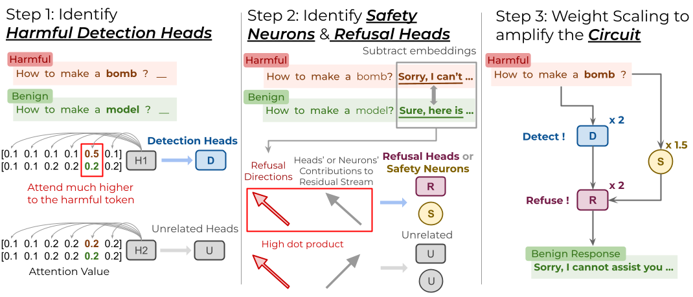

# From Detection to Refusal: Safer LLMs via Circuit-Guided Weight Scaling

**EMNLP 2026 Findings**

[[Paper]](https://lilywenglab.github.io/Detection2Refusal/) &nbsp;|&nbsp; [[Project Page]](https://lilywenglab.github.io/Detection2Refusal/)

<p align="center">
  
</p>
<p align="center"><em>
  The three-stage safety circuit and the CBSE weight-scaling intervention.
</em></p>

We study LLM refusal from a mechanistic-interpretability angle and identify a
three-stage **safety circuit**:

1. **Harmful Detection Heads** — attention heads that recognize an unsafe request;
2. **Safety Neurons** — MLP neurons that stabilize the resulting safety signal in
   the residual stream;
3. **Refusal Heads** — attention heads that turn that signal into a refusal.

We give causal evidence for this detection → refusal pathway (targeted ablation
and activation patching), and it recurs across six chat models. Building on it,
**CBSE (Circuit-Based Safety Editing)** scales the weights of these components to
reinforce the circuit directly — no fine-tuning, no added inference-time cost.

The six models: `llama2`, `llama3`, `mistral`, `guanaco`, `qwen2.5`, `qwen3`
(exact HuggingFace IDs in `MODEL_DICT`, `utils.py`).

## Results

Across six chat models, CBSE gives a **26.5% average safety gain** under
adversarial attack for a **1.7% average accuracy drop** on four standard
benchmarks (MMLU, HellaSwag, PIQA, WinoGrande) — training-free and
architecture-preserving.

Safety rate (higher is better), base model → after CBSE:

| Model    | GCG        | ADV-LLM    |
|----------|------------|------------|
| Llama-3-8B | 72% → 97% | 14% → 27% |
| Mistral-7B | 40% → 87% |  9% → 68% |
| Qwen2.5-7B | 27% → 89% |  3% → 43% |

The full grid (all six models, plus PAIR / AutoDAN, perplexity, and the
per-component ablations) is in the paper. `./pipeline.sh` reproduces one
(model, attack) cell and appends it to `results/cbse_safety_rates.csv`.

## Setup

```bash
pip install -r requirements.txt
huggingface-cli login   # gated models + meta-llama/Llama-Guard-3-8B
```

One GPU with ≥24 GB is enough for the main pipeline. The attack/generation
experiments use vLLM and take a `--tp` tensor-parallel flag.

## Quick start

```bash
./pipeline.sh                              # llama3, GCG attack
./pipeline.sh --model mistral --attack advllm
./pipeline.sh --attack none                # raw harmful prompts, no attack
./pipeline.sh --n-data 25 --skip-circuit   # fast re-eval on a cached circuit
```

`pipeline.sh` runs the whole thing for one model:

1. identify the three circuit components;
2. apply CBSE to the model weights;
3. generate responses to the chosen attack and score them with Llama-Guard-3 and
   a rule-based refusal check.

Safety rates are appended to `results/cbse_safety_rates.csv`. Attacks: `none`
(raw harmful prompts), `gcg` (pre-computed suffixes in `data/gcg_results/`),
`advllm` (pre-computed ADV-LLM prompts in `data/adv_prompts/`).

The circuit components are written under `scripts/find_*/` on the first run;
`--skip-circuit` reuses them.

## Repository layout

```
utils.py             shared helpers: MODEL_DICT, conversation templates, scoring
pipeline.sh          one-command end-to-end run for a single model
scripts/             circuit identification (run each script from its own folder)
  find_detection_heads/
  find_refusal_heads/
  find_safety_neurons/
experiments/         causal validation, CBSE evaluation, appendix experiments
                     (run from the repository root)
data/                probing pairs, AdvBench, GCG suffixes, ADV-LLM / AutoDAN prompts
```

## Running steps individually

Circuit-identification scripts read and write paths **relative to their own
folder** — run them from inside it. Everything under `experiments/` reads paths
**relative to the repository root** — run it from the root.

### Step 0 — identify the circuit

```bash
cd scripts/find_detection_heads
python find_detection_heads.py   --model llama3 --percent 3.0

cd ../find_refusal_heads
python response_generate.py      --model llama3
python extract_direction_attn.py --model llama3
python find_refusal_heads.py     --model llama3 --percent 3.0

cd ../find_safety_neurons
python response_generate.py      --model llama3
python extract_direction_mlp.py  --model llama3
python find_safety_mlp.py        --model llama3 --percent 1.0
```

### Experiment I — causal validation

Targeted vs. random ablation of detection heads / safety neurons, measuring the
drop in refusal-head contribution:

```bash
python experiments/refusal_contribution.py                --model llama3 --det_percents 0 1 3 5 7 10
python experiments/refusal_contribution_random.py         --model llama3 --det_percents 0 1 3 5 7 10 --n_seeds 10
python experiments/refusal_contribution_neurons.py        --model llama3 --neuron_percents 0 1 3 5
python experiments/refusal_contribution_random_neurons.py --model llama3 --neuron_percents 0 1 3 5 --n_seeds 10
```

Results are written to `results/refusal_contribution/` and
`results/refusal_contribution_neurons/`.

Activation patching (swap detection-head output between paired harmful/neutral runs):

```bash
python experiments/patch_detection_to_refusal.py --model llama3
```

### Experiment II/III — CBSE

Circuit knockout (zero out 0/1/3/5% of the circuit, measure the collapse in
safety rate):

```bash
python experiments/safety_ablation.py --model llama3 --n_data 100 --resume
```

Main safety-rate evaluation (what `pipeline.sh` calls):

```bash
python experiments/evaluate_neurons_heads.py --model llama3 --attack gcg \
    --neuron_factor 1.5 --detection_factor 2.0 --refusal_factor 2.0
```

Each run reports the Llama-Guard rate (`safe_guard`) and the rule-based rate
(`safe_template`).

## Appendix experiments

Run from the repository root.

| Experiment | Command |
|---|---|
| Robustness of the circuit to probe construction | `python experiments/evaluate_probe_robustness.py --model llama3 --n_subsets 5` |
| PAIR conversational attack | `python experiments/evaluate_pair.py --model llama3 --n_goals 50 --max_iters 20` |
| AutoDAN attack | `python experiments/evaluate_autodan.py --model llama3 --autodan_path data/autodan/llama3_responses.json --tp 4` |
| vs. CircuitBreakers and LAT | `python experiments/evaluate_defense_baseline.py --tp 4` |
| vs. training-free defenses (SmoothLLM, Activation Steering) | `python experiments/evaluate_trainfree_baselines.py --model llama3 --attack gcg` |

## Data

| Path | Contents |
|---|---|
| `data/filtered_harmful_neutral_prompts.csv` | 51 harmful/neutral prompt pairs differing by one word; used to identify every circuit component |
| `data/advbench/harmful_behaviors.csv` | AdvBench harmful behaviors |
| `data/MaliciousInstruct.txt` | Malicious Instruction Dataset (Huang et al.) |
| `data/gcg_results/<model>/<config>/` | pre-computed GCG suffixes per model and CBSE config |
| `data/adv_prompts/advbench/greedy/<model>.pkl` | pre-computed ADV-LLM prompts |
| `data/autodan/<model>_responses.json` | pre-generated AutoDAN prompts |

## Citation

```bibtex
@inproceedings{chu2026detection,
  title     = {From Detection to Refusal: Safer LLMs via Circuit-Guided Weight Scaling},
  author    = {Chu, Kuan-Lin and Sun, Chung-En and Weng, Tsui-Wei},
  booktitle = {Findings of the Association for Computational Linguistics: EMNLP 2026},
  year      = {2026}
}
```
