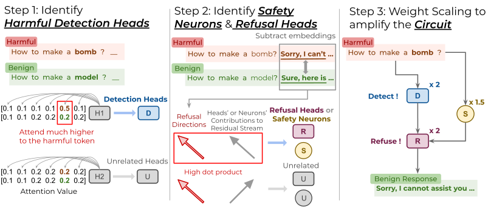

# From Detection to Refusal: Safer LLMs via Circuit-Guided Weight Scaling

2026/08/20 Update: Our paper has been accepted to EMNLP 2026 Findings!

Official repository for [**From Detection to Refusal: Safer LLMs via Circuit-Guided Weight Scaling**](https://lilywenglab.github.io/Detection2Refusal/).

[[Paper]](https://lilywenglab.github.io/Detection2Refusal/) | [[Project Page]](https://lilywenglab.github.io/Detection2Refusal/)

<p align="center">
  
</p>

## Overview

Refusal in aligned LLMs is organized by a compact three-stage **safety circuit**:
**Harmful Detection Heads** recognize an unsafe request → **Safety Neurons**
stabilize the resulting safety signal in the residual stream → **Refusal Heads**
turn it into a refusal. Building on this, **CBSE (Circuit-Based Safety Editing)**
scales the weights of those components to reinforce the circuit in place.

Key findings:
- The circuit recurs across six chat models (llama2/3, mistral, guanaco, qwen2.5/3).
- Ablating detection heads or safety neurons collapses the refusal heads'
  contribution far more than removing random components; activation patching shows
  detection heads *directly* drive refusal heads, not a shared upstream cause.
- CBSE is training-free, architecture-preserving, and adds no inference-time cost.
- Across the six models CBSE gives a **26.5% average safety-rate gain** under
  adversarial attack (GCG, ADV-LLM, PAIR, AutoDAN) for a **1.7% average accuracy
  drop** on MMLU / HellaSwag / PIQA / WinoGrande.

## Quick start

### Setup

```bash
pip install -r requirements.txt
huggingface-cli login   # gated models + meta-llama/Llama-Guard-3-8B
```

One GPU with ≥24 GB is enough for the main pipeline. The attack/generation
experiments use vLLM and take a `--tp` tensor-parallel flag.

### Run

```bash
./pipeline.sh                              # llama3, GCG attack
./pipeline.sh --model mistral --attack advllm
./pipeline.sh --attack none                # raw harmful prompts, no attack
./pipeline.sh --n-data 25 --skip-circuit   # fast re-eval on a cached circuit
```

`pipeline.sh` runs the whole thing for one model:

1. identify the three circuit components;
2. apply CBSE to the model weights;
3. generate responses to the chosen attack and score them with Llama-Guard-3 and
   a rule-based refusal check.

Safety rates are appended to `results/cbse_safety_rates.csv`. Attacks: `none`
(raw harmful prompts), `gcg` (pre-computed suffixes in `data/gcg_results/`),
`advllm` (pre-computed ADV-LLM prompts in `data/adv_prompts/`).

The circuit components are written under `scripts/find_*/` on the first run;
`--skip-circuit` reuses them.

## Supported models

Pass any alias below as `--model`; exact IDs live in `MODEL_DICT` (`utils.py`).

| Alias | HuggingFace path |
|-------|------------------|
| `llama2`  | meta-llama/Llama-2-7b-chat-hf |
| `llama3`  | meta-llama/Meta-Llama-3-8B-Instruct |
| `mistral` | mistralai/Mistral-7B-Instruct-v0.2 |
| `guanaco` | TheBloke/guanaco-7B-HF |
| `qwen2.5` | Qwen/Qwen2.5-7B-Instruct |
| `qwen3`   | Qwen/Qwen3-4B-Instruct-2507 |

## Results

Safety rate under the GCG attack (100 AdvBench prompts, Llama-Guard-3 judge),
base model → after CBSE:

| Model | GCG (base → CBSE) |
|-------|-------------------|
| llama2  | 55% → 95% |
| llama3  | 72% → 97% |
| mistral | 40% → 87% |
| guanaco |  6% → 45% |
| qwen2.5 | 27% → 89% |
| qwen3   | 53% → 100% |

The full grid (ADV-LLM / PAIR / AutoDAN, utility benchmarks, perplexity, and the
per-component ablations) is in the paper. `./pipeline.sh` reproduces one
(model, attack) cell and appends it to `results/cbse_safety_rates.csv`.

## Running steps individually

Circuit-identification scripts read and write paths **relative to their own
folder** — run them from inside it. Everything under `experiments/` reads paths
**relative to the repository root** — run it from the root.

### Identify the Circuit

```bash
cd scripts/find_detection_heads
python find_detection_heads.py   --model llama3 --percent 3.0

cd ../find_refusal_heads
python response_generate.py      --model llama3
python extract_direction_attn.py --model llama3
python find_refusal_heads.py     --model llama3 --percent 3.0

cd ../find_safety_neurons
python response_generate.py      --model llama3
python extract_direction_mlp.py  --model llama3
python find_safety_mlp.py        --model llama3 --percent 1.0
```

### Experiment I — causal validation

Targeted vs. random ablation of detection heads / safety neurons, measuring the
drop in refusal-head contribution:

```bash
python experiments/refusal_contribution.py                --model llama3 --det_percents 0 1 3 5 7 10
python experiments/refusal_contribution_random.py         --model llama3 --det_percents 0 1 3 5 7 10 --n_seeds 10
python experiments/refusal_contribution_neurons.py        --model llama3 --neuron_percents 0 1 3 5
python experiments/refusal_contribution_random_neurons.py --model llama3 --neuron_percents 0 1 3 5 --n_seeds 10
```

Results are written to `results/refusal_contribution/` and
`results/refusal_contribution_neurons/`.

Activation patching (swap detection-head output between paired harmful/neutral runs):

```bash
python experiments/patch_detection_to_refusal.py --model llama3
```

### Experiment II/III — CBSE

Circuit knockout (zero out 0/1/3/5% of the circuit, measure the collapse in
safety rate):

```bash
python experiments/safety_ablation.py --model llama3 --n_data 100 --resume
```

Main safety-rate evaluation (what `pipeline.sh` calls):

```bash
python experiments/evaluate_neurons_heads.py --model llama3 --attack gcg \
    --neuron_factor 1.5 --detection_factor 2.0 --refusal_factor 2.0
```

Each run reports the Llama-Guard rate (`safe_guard`) and the rule-based rate
(`safe_template`).

## Appendix experiments

Run from the repository root.

| Experiment | Command |
|---|---|
| Robustness of the circuit to probe construction | `python experiments/evaluate_probe_robustness.py --model llama3 --n_subsets 5` |
| PAIR conversational attack | `python experiments/evaluate_pair.py --model llama3 --n_goals 50 --max_iters 20` |
| AutoDAN attack | `python experiments/evaluate_autodan.py --model llama3 --autodan_path data/autodan/llama3_responses.json --tp 4` |
| vs. CircuitBreakers and LAT | `python experiments/evaluate_defense_baseline.py --tp 4` |
| vs. training-free defenses (SmoothLLM, Activation Steering) | `python experiments/evaluate_trainfree_baselines.py --model llama3 --attack gcg` |

## Data

| Path | Contents |
|---|---|
| `data/filtered_harmful_neutral_prompts.csv` | 51 harmful/neutral prompt pairs differing by one word; used to identify every circuit component |
| `data/advbench/harmful_behaviors.csv` | AdvBench harmful behaviors |
| `data/MaliciousInstruct.txt` | Malicious Instruction Dataset (Huang et al.) |
| `data/gcg_results/<model>/<config>/` | pre-computed GCG suffixes per model and CBSE config |
| `data/adv_prompts/advbench/greedy/<model>.pkl` | pre-computed ADV-LLM prompts |
| `data/autodan/<model>_responses.json` | pre-generated AutoDAN prompts |

## Project Structure

```
.
├── pipeline.sh                          # one-command end-to-end run for a single model
├── requirements.txt
├── utils.py                             # MODEL_DICT, conversation templates, shared scoring
├── scripts/                             # circuit identification (run each from its own folder)
│   ├── find_detection_heads/
│   │   ├── find_detection_heads.py          # Harmful Detection Heads
│   │   └── detection_head_intervention.py   # single-component ablation
│   ├── find_refusal_heads/
│   │   ├── response_generate.py             # model responses to the probing pairs (vLLM)
│   │   ├── extract_direction_attn.py        # refusal direction
│   │   ├── find_refusal_heads.py            # Refusal Heads
│   │   └── refusal_head_intervention.py
│   └── find_safety_neurons/
│       ├── response_generate.py
│       ├── extract_direction_mlp.py         # safety direction
│       ├── find_safety_mlp.py               # Safety Neurons
│       └── safety_neuron_intervention.py
├── experiments/                         # causal validation + CBSE eval (run from repo root)
│   ├── refusal_contribution*.py             # Exp I: targeted vs. random ablation
│   ├── patch_detection_to_refusal.py        # Exp I: activation patching
│   ├── safety_ablation.py                   # Exp II: circuit knockout
│   ├── evaluate_neurons_heads.py            # Exp II/III: CBSE safety-rate eval (pipeline.sh)
│   ├── evaluate_probe_robustness.py         # appendix: robustness to probe construction
│   ├── evaluate_pair.py                     # appendix: PAIR attack
│   ├── evaluate_autodan.py                  # appendix: AutoDAN attack
│   ├── evaluate_defense_baseline.py         # appendix: vs. CircuitBreakers / LAT
│   └── evaluate_trainfree_baselines.py      # appendix: vs. SmoothLLM / Activation Steering
├── figs/
└── data/                                # probing pairs, AdvBench, GCG suffixes, ADV-LLM / AutoDAN prompts
```

## Citation

```bibtex
@inproceedings{chu2026detection,
  title     = {From Detection to Refusal: Safer LLMs via Circuit-Guided Weight Scaling},
  author    = {Chu, Kuan-Lin and Sun, Chung-En and Weng, Tsui-Wei},
  booktitle = {Findings of the Association for Computational Linguistics: EMNLP 2026},
  year      = {2026}
}
```
